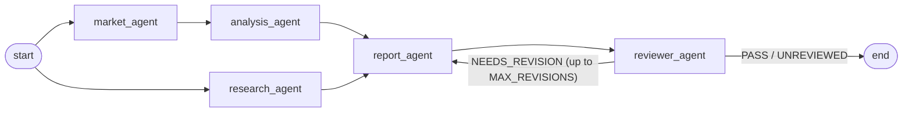

# Financial Research Assistant

A multi-agent workflow (built with [LangGraph](https://langchain-ai.github.io/langgraph/))
that produces a short, evidence-based research report for forex and metal
instruments. Technical indicators are computed in code; the LLMs only
interpret the numbers, summarize news, write the report and review it.

> **Disclaimer:** this project is for research and education. Its output is
> not financial advice and makes no guarantee about future prices.

## How it works



| Node | What it does |
| --- | --- |
| `market_agent` | Fetches closed OHLC candles (Twelve Data), computes SMA/EMA/RSI/MACD in pandas, builds a market summary (including a data-freshness check) and asks the LLM to interpret it. |
| `analysis_agent` | A second, independent interpretation of the same summary. |
| `research_agent` | Searches recent news (Tavily) and extracts validated, structured findings. URLs, titles and dates are copied from the real search results, never trusted from the LLM. |
| `report_agent` | Writes the final report from the evidence. On a revision it receives its previous draft plus the reviewer's feedback. |
| `reviewer_agent` | Returns a structured verdict (`PASS` / `NEEDS_REVISION`) with critical issues and recommendations. |

Design notes:

- `market_agent` and `research_agent` run **in parallel**; `report_agent`
  waits for both.
- A failure in market data, analysis or the report stops the workflow (after
  retrying transient errors such as timeouts, 429 and 5xx). A failure in
  research or review **degrades gracefully**: the problem is recorded in
  `errors`, passed to the report as a limitation, and the workflow continues.
- If data is stale (for example over a weekend), the report is told to say the
  prices may not be live.

## Setup

Requires Python 3.11+.

```bash
python -m venv .venv
source .venv/bin/activate        # Windows: .venv\Scripts\activate
pip install -r requirements.txt  # installs the package + dev tools
cp .env.example .env             # then fill in your keys
```

| Variable | Required | Description |
| --- | --- | --- |
| `OPENAI_API_KEY` | yes | API key for the LLM provider. |
| `OPENAI_MODEL` | yes | Model name. |
| `OPENAI_BASE_URL` | no | Custom OpenAI-compatible endpoint. |
| `TWELVE_DATA_API_KEY` | yes | Market data. |
| `TAVILY_API_KEY` | yes | News search. |
| `MAX_REVISIONS` | no | Max reviewer-requested revisions (default `2`). |
| `LANGSMITH_*` | no | Optional tracing. |

Check your LLM connection with `python scripts/check_model.py`.

## Usage

Command line:

```bash
financial-assistant                                   # XAU/USD, 1h
financial-assistant --symbol EUR/USD --interval 4h
financial-assistant --query "How does the dollar affect gold?" --show-review
financial-assistant -o report.md                      # also save the report
financial-assistant --json                            # full workflow state
```

`python -m financial_assistant ...` works as well. Supported symbols and
intervals are listed by `financial-assistant --help`.

From Python:

```python
from financial_assistant.graph import financial_graph

result = financial_graph.invoke(
    {"user_query": "Analyze gold", "symbol": "XAU/USD", "interval": "1h"}
)
print(result["final_report"])
print(result["review"]["verdict"], result.get("errors"))
```

## Tests

```bash
pytest          # offline: no API keys, no network
ruff check src tests evaluation scripts
```

All tests use fake models and fake data. Scripts that call the real APIs
(and cost money / quota) live in `scripts/manual/` and are never collected by
pytest, for example `python scripts/manual/run_graph.py`.

## Evaluation

`evaluation/` runs the **real workflow with frozen inputs** (synthetic but
deterministic market data and fixed news; only the LLM calls are real) and
scores each report with deterministic checks:

| Check | Verifies |
| --- | --- |
| `required_sections` | All seven sections are present. |
| `word_limit` | Report stays within 600 words. |
| `grounded_numbers` | Every price / indicator number in the report exists in the market data or news (matched at the precision it is written). |
| `sources_from_research` | Every URL in the report comes from the research findings. |
| `no_guarantees_or_advice` | No guarantees or buy/sell instructions. |
| `stale_data_disclosed` | Stale data is not presented as live. |

```bash
python -m evaluation.run_eval                      # all scenarios
python -m evaluation.run_eval --scenario gold_stale_weekend_data
python -m evaluation.run_eval --fail-on-error      # non-zero exit if a check fails
```

This needs your LLM keys. Results are written to `evaluation/results/`
(git-ignored). Use it to compare prompt or model changes before committing
them.

## Project structure

```text
src/financial_assistant/
  cli.py, __main__.py     command line entry point
  graph.py                LangGraph workflow and revision routing
  state.py, schemas.py    shared state and Pydantic schemas
  config.py               model factory and settings
  retry.py, parsing.py    transient-error retries, parse-and-retry helper
  nodes/                  the five agents
  tools/                  market data, indicators, market summary, web search
tests/                    offline unit and end-to-end tests
evaluation/               frozen scenarios, evaluators, runner
scripts/                  manual scripts that call real APIs
```

## Known limitations

- Only `XAU/USD` and `EUR/USD`, intervals `1h`, `4h`, `1day`.
- `market_agent` and `analysis_agent` currently interpret the same summary.
- No backtest yet, so there is no measurement of whether the reports are directionally useful.
